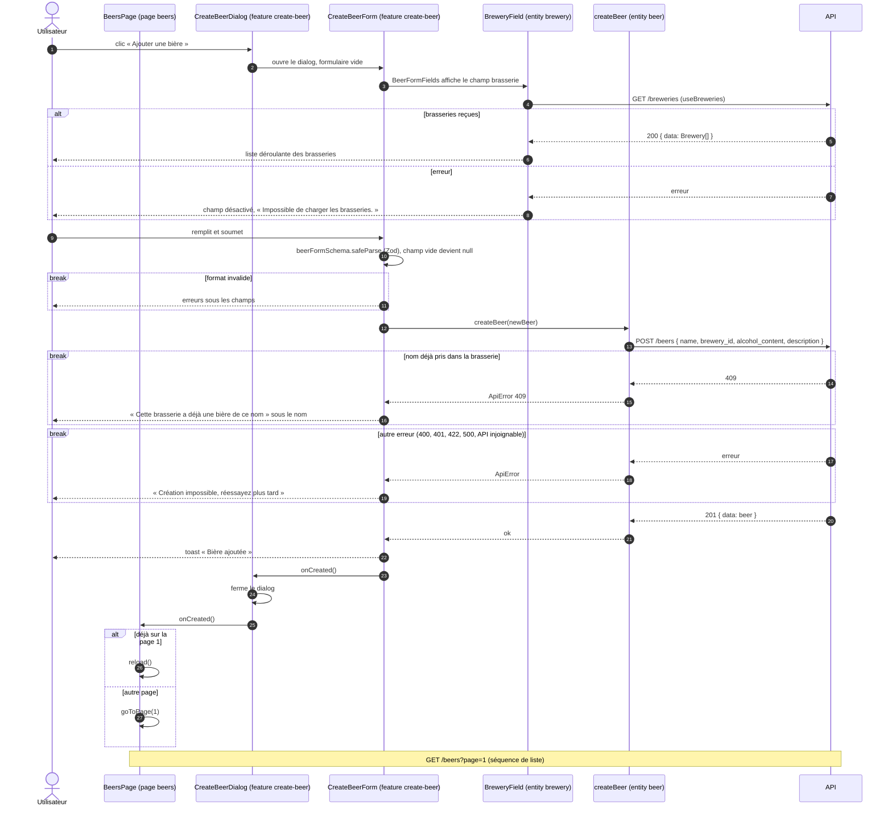

# Séquence — création d'une bière côté client

Du bouton « Ajouter une bière » à la liste rechargée :

- [`BeersPage.tsx`](../../src/pages/beers/ui/BeersPage.tsx)
- [`CreateBeerDialog.tsx`](../../src/features/create-beer/ui/CreateBeerDialog.tsx)
- [`CreateBeerForm.tsx`](../../src/features/create-beer/ui/CreateBeerForm.tsx)
- [`BeerFormFields.tsx`](../../src/entities/beer/ui/BeerFormFields.tsx)
- [`beer-form-schema.ts`](../../src/entities/beer/model/beer-form-schema.ts)
- [`BreweryField.tsx`](../../src/entities/brewery/ui/BreweryField.tsx)
- [`create-beer.ts`](../../src/entities/beer/api/create-beer.ts)

## Notes

- La liste est triée de la plus récente à la plus ancienne : on revient en
  page 1, où la nouvelle bière apparaît en tête. Le rechargement suit la
  [séquence de liste](list-beers-sequence.md).
- Chaque participant porte sa couche FSD. `BreweryField` vient de l'entité
  `brewery` alors que le formulaire est celui d'une bière : `BeerFormFields`
  (entité `beer`) l'importe via la notation `@x`. `BeerFormFields` n'est pas
  dessiné, il ne fait qu'afficher les champs. `apiFetch` (`shared/api`) non
  plus : `createBeer` s'en sert et lève une `ApiError` si la réponse n'est
  pas `ok`.
- Le formulaire n'est pas contrôlé (`defaultValue`, `FormData`) : le dialog
  démonte son contenu à la fermeture, il repart vide à chaque ouverture.
- Le bouton n'est désactivé que pendant l'envoi (« Ajout… »), jamais pendant
  le chargement des brasseries : le schéma Zod signale un champ manquant.
- Le 422 (brasserie inexistante) ne peut pas arriver depuis la liste
  déroulante, sauf si la brasserie est supprimée entre-temps : il tombe dans
  l'erreur générique.
