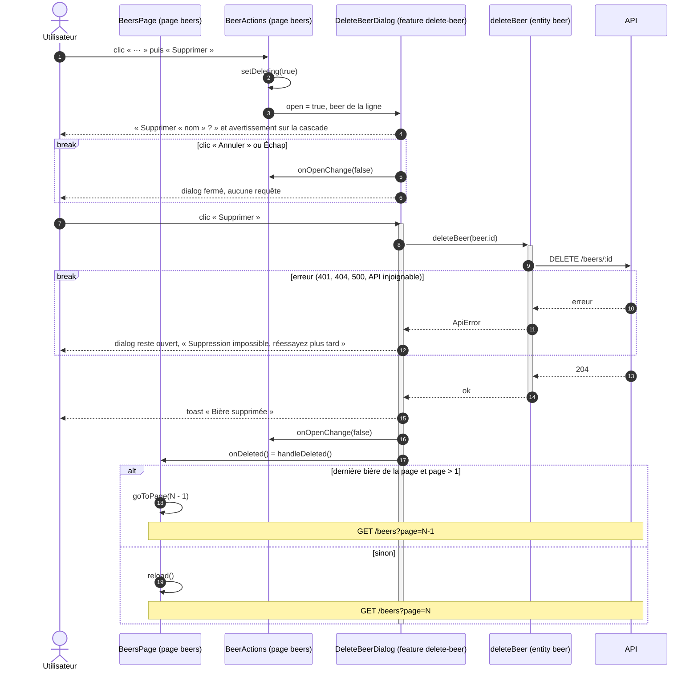

# Séquence — suppression d'une bière côté client (livré)

Du menu « ⋯ » d'une ligne à la liste rechargée :

- [`BeersPage.tsx`](../../src/pages/beers/ui/BeersPage.tsx) (`handleDeleted`)
- [`BeerActions.tsx`](../../src/pages/beers/ui/BeerActions.tsx)
- [`DeleteBeerDialog.tsx`](../../src/features/delete-beer/ui/DeleteBeerDialog.tsx)
- [`delete-beer.ts`](../../src/entities/beer/api/delete-beer.ts)

## Notes

- Les barres d'activation montrent qui attend la réponse. Celle de
  `DeleteBeerDialog` correspond à `pending` : le bouton reste désactivé
  (« Suppression… ») de l'appel jusqu'au `finally`, une fois le callback du parent appelé. Le `GET` de rechargement part ensuite, depuis l'effet de `useBeers`.
- `AlertDialog` plutôt que `Dialog` : rôle `alertdialog`, et un clic à
  l'extérieur ne le ferme pas. L'action est irréversible.
- `AlertDialogAction` ne ferme pas le dialog tout seul : il ne se ferme
  qu'après le 204, pour pouvoir afficher l'erreur sinon.
- Sans le retour à la page précédente, supprimer la seule bière de la
  dernière page afficherait une page vide.
- Côté API, la suppression part en cascade : avis, favoris, photos,
  compositions, catégorisations et mises en vente liés à la bière.
- Chaque participant porte sa couche FSD. Non dessinés : `getBeerColumns`
  (`columns.tsx`), qui transmet `onDeleted` de `BeersPage` à `BeerActions`
  dans la cellule d'actions, et
  `apiFetch` (`shared/api`), dont `deleteBeer` se sert et qui lève une
  `ApiError` si la réponse n'est pas `ok`.
- Le rechargement suit la [séquence de liste](list-beers-sequence.md).
