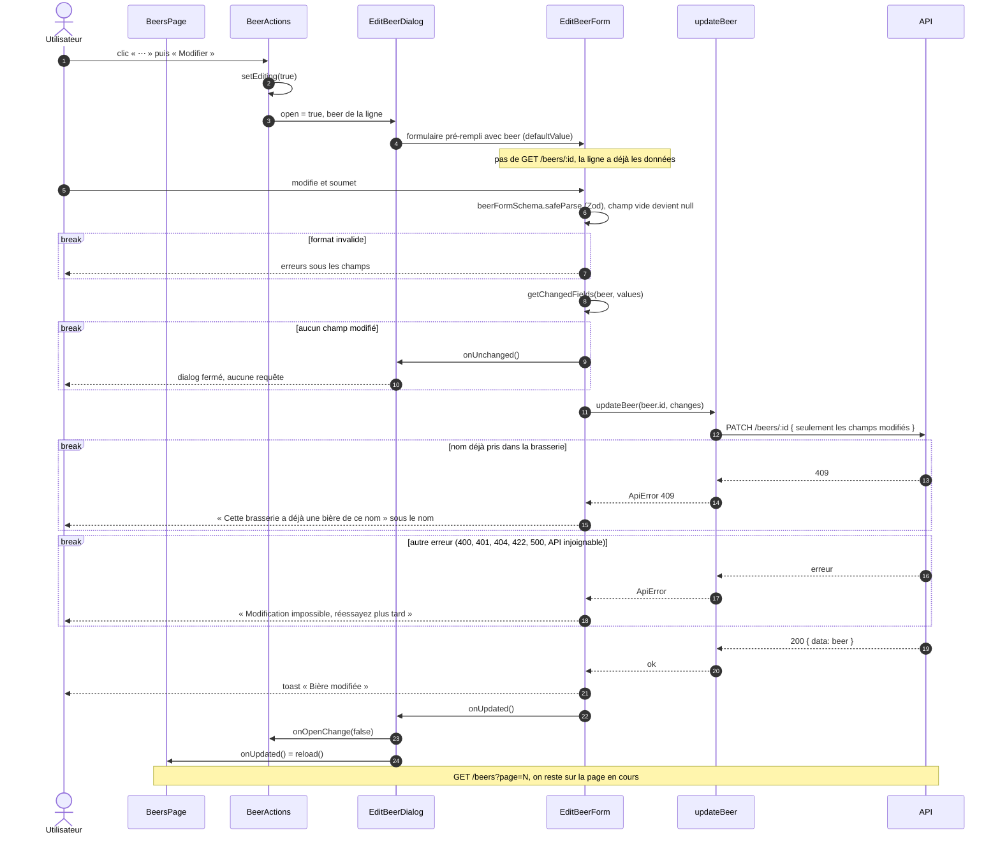

# Séquence — modification d'une bière côté client

Du menu « ⋯ » d'une ligne à la liste rechargée :

- [`BeersPage.tsx`](../../src/pages/beers/ui/BeersPage.tsx) (`BeerActions`)
- [`EditBeerDialog.tsx`](../../src/features/edit-beer/ui/EditBeerDialog.tsx)
- [`EditBeerForm.tsx`](../../src/features/edit-beer/ui/EditBeerForm.tsx)
- [`get-changed-fields.ts`](../../src/features/edit-beer/model/get-changed-fields.ts)
- [`beer-form-schema.ts`](../../src/entities/beer/model/beer-form-schema.ts)
- [`update-beer.ts`](../../src/entities/beer/api/update-beer.ts)

## Notes

- `PATCH` et non `PUT` : une clé absente laisse la colonne intacte, `null`
  l'efface. `getChangedFields` n'envoie donc que ce qui diffère de `beer`.
- Un champ vidé part à `null` (« effacer »), pas absent (« ne pas toucher ») :
  c'est le rôle des transformations du schéma.
- `initial` est typé `BeerFormValues` dans `getChangedFields` : un champ ajouté
  au schéma mais oublié ici ne compile pas.
- C'est `BeerActions` qui tient `open` : le menu se démonte en se fermant, il
  ne peut pas porter le `DialogTrigger`.
