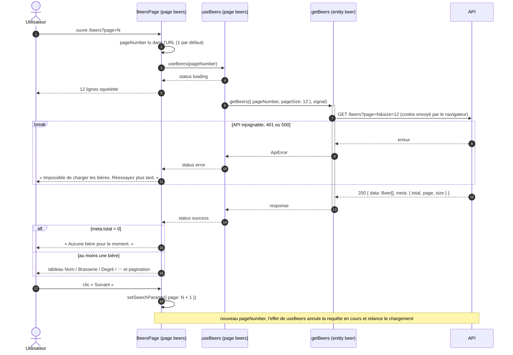

# Séquence — liste des bières côté client (livré)

De l'URL `/beers?page=N` au tableau paginé :

- [`BeersPage.tsx`](../../src/pages/beers/ui/BeersPage.tsx)
- [`use-beers.ts`](../../src/pages/beers/model/use-beers.ts)
- [`get-beers.ts`](../../src/entities/beer/api/get-beers.ts)

## Notes

- La barre d'activation de `getBeers` montre l'attente de la réponse.
  `useBeers` n'en a pas : l'effet lance la requête et se termine aussitôt,
  la réponse revient plus tard par un `setLastResult`.
- La page est dans l'URL et non dans un state : F5 et « précédent » la
  conservent.
- `useBeers` passe un `AbortController` à `getBeers` : la réponse d'une page
  quittée ne peut pas écraser celle de la page suivante.
- `reload()` relance la même requête sans changer de page. La
  [création](create-beer-sequence.md), la
  [modification](edit-beer-sequence.md) et la
  [suppression](delete-beer-sequence.md) s'en servent pour rafraîchir la
  liste.
- Chaque participant porte sa couche FSD : `page` importe `entity`, jamais
  l'inverse. `apiFetch` (`shared/api`) n'est pas dessiné : `getBeers` s'en
  sert pour l'appel HTTP et lève une `ApiError` si la réponse n'est pas `ok`.
- `GET /beers` ne renvoie que la brasserie (id et nom) : le détail d'une bière
  passe par `GET /beers/:id`, non utilisé par le client à ce stade.
