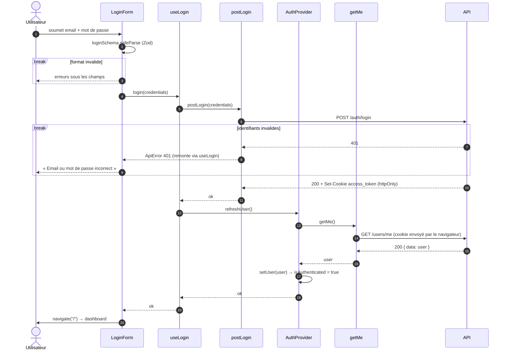

Z# Séquence — login côté client

Du formulaire au dashboard, en passant par l'`AuthContext` :

- [`LoginForm.tsx`](../../src/pages/login/ui/LoginForm.tsx)
- [`use-login.ts`](../../src/pages/login/model/use-login.ts)
- [`post-login.ts`](../../src/pages/login/api/post-login.ts)
- [`auth-provider.tsx`](../../src/entities/user/model/auth-provider.tsx)
- [`get-me.ts`](../../src/entities/user/api/get-me.ts)

Le détail côté serveur est dans le
[diagramme de l'API](../../../api/docs/diagrams/login-sequence.md).

## Notes

- `LoginForm` ne connaît que `login()` : `useLogin` enchaîne l'appel API et
  la mise à jour du contexte.
- `refreshUser()` est attendu **avant** `navigate("/")` : le dashboard
  s'affiche avec un utilisateur déjà chargé.
- Le JavaScript ne lit jamais le cookie (`httpOnly`) : c'est `GET /users/me`
  qui dit au client qui est connecté.
- Toute autre erreur (API injoignable, 500, échec de `refreshUser`) remonte
  au formulaire, qui affiche « Connexion impossible, réessayez plus tard ».
