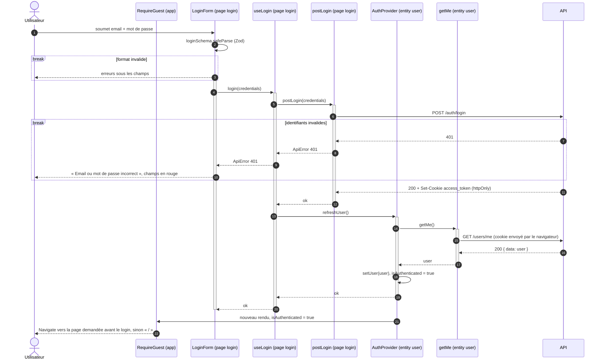

# Séquence — login côté client (livré)

Du formulaire au dashboard, en passant par l'`AuthContext` :

- [`LoginForm.tsx`](../../src/pages/login/ui/LoginForm.tsx)
- [`use-login.ts`](../../src/pages/login/model/use-login.ts)
- [`post-login.ts`](../../src/pages/login/api/post-login.ts)
- [`AuthProvider.tsx`](../../src/entities/user/model/AuthProvider.tsx)
- [`get-me.ts`](../../src/entities/user/api/get-me.ts)
- [`RequireGuest.tsx`](../../src/app/routes/RequireGuest.tsx)

Le détail côté serveur est dans le
[diagramme de l'API](../../../api/docs/diagrams/login-sequence.md).

## Notes

- Chaque participant porte sa couche FSD. `useLogin` et `postLogin` restent
  dans la page `login` : ce n'est pas une action réutilisable ailleurs.
  `apiFetch` (`shared/api`) n'est pas dessiné : `postLogin` et `getMe` s'en
  servent et il lève une `ApiError` si la réponse n'est pas `ok`.
- Les barres d'activation montrent qui attend la réponse. Celle de
  `LoginForm` correspond à `isSubmitting` : le bouton reste désactivé
  jusqu'à la fin de `refreshUser()`.
- `LoginForm` ne navigue pas. Dès que `isAuthenticated` passe à `true`,
  `RequireGuest` redirige vers `from`, la page que `RequireAuth` avait
  mémorisée en renvoyant vers `/login`, ou vers `/` par défaut.
- Le JavaScript ne lit jamais le cookie (`httpOnly`) : c'est `GET /users/me`
  qui dit au client qui est connecté.
- Toute autre erreur (API injoignable, 500, échec de `refreshUser`) remonte
  au formulaire, qui affiche « Connexion impossible, réessayez plus tard ».
- La déconnexion suit la [séquence de logout](logout-sequence.md).
