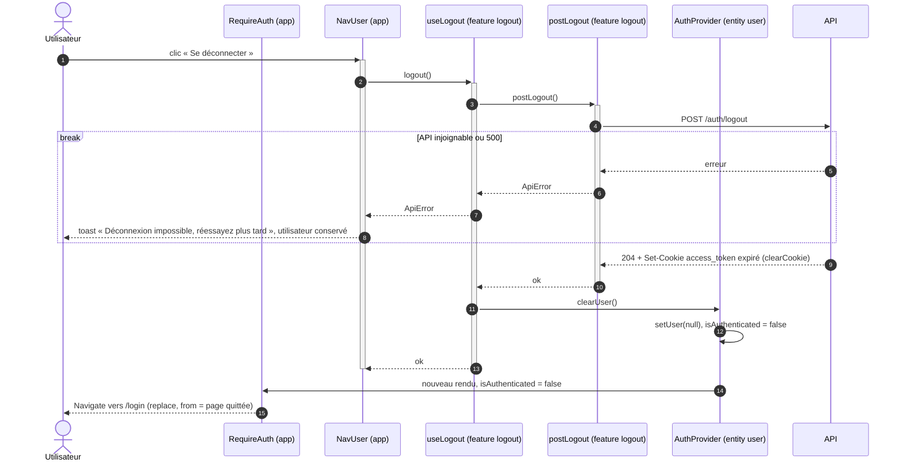

# Séquence — logout côté client (livré)

Du menu utilisateur à la page de login, en vidant l'`AuthContext` :

- [`NavUser.tsx`](../../src/app/layouts/NavUser.tsx)
- [`use-logout.ts`](../../src/features/logout/model/use-logout.ts)
- [`post-logout.ts`](../../src/features/logout/api/post-logout.ts)
- [`AuthProvider.tsx`](../../src/entities/user/model/AuthProvider.tsx)
- [`RequireAuth.tsx`](../../src/app/routes/RequireAuth.tsx)

## Notes

- Chaque participant porte sa couche FSD. `NavUser` est dans `app/layouts`,
  le cadre des pages connectées, et appelle la feature `logout`. `apiFetch`
  (`shared/api`) n'est pas dessiné : `postLogout` s'en sert et il lève une
  `ApiError` si la réponse n'est pas `ok`.
- Les barres d'activation montrent qui attend la réponse. `clearUser()` est
  synchrone, il n'en a pas.
- `NavUser` ne navigue pas. Dès que `isAuthenticated` passe à `false`,
  `RequireAuth` redirige vers `/login` en mémorisant la page quittée :
  le prochain login y ramène (voir la [séquence de login](login-sequence.md)).
- `clearUser()` n'est appelé qu'après un `POST /auth/logout` réussi : le
  client ne se croit pas déconnecté tant que le cookie existe.
- `POST /auth/logout` répond 204 même sans session (idempotent, cf.
  [`AUTH.md`](../../../api/AUTH.md)).
