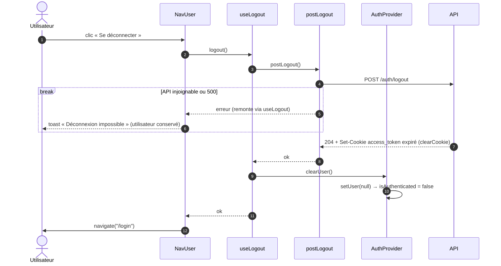

# Séquence — logout côté client

Du menu utilisateur à la page de login, en vidant l'`AuthContext` :

- [`nav-user.tsx`](../../src/pages/dashboard/ui/nav-user.tsx)
- [`use-logout.ts`](../../src/features/logout/model/use-logout.ts)
- [`post-logout.ts`](../../src/features/logout/api/post-logout.ts)
- [`auth-provider.tsx`](../../src/entities/user/model/auth-provider.tsx)

## Notes

- `NavUser` ne connaît que `logout()` : `useLogout` enchaîne l'appel API et
  la mise à jour du contexte.
- `clearUser()` n'est appelé qu'après un `POST /auth/logout` réussi : le
  client ne se croit pas déconnecté tant que le cookie existe.
- `POST /auth/logout` répond 204 même sans session (idempotent, cf.
  [`AUTH.md`](../../../api/AUTH.md)).
