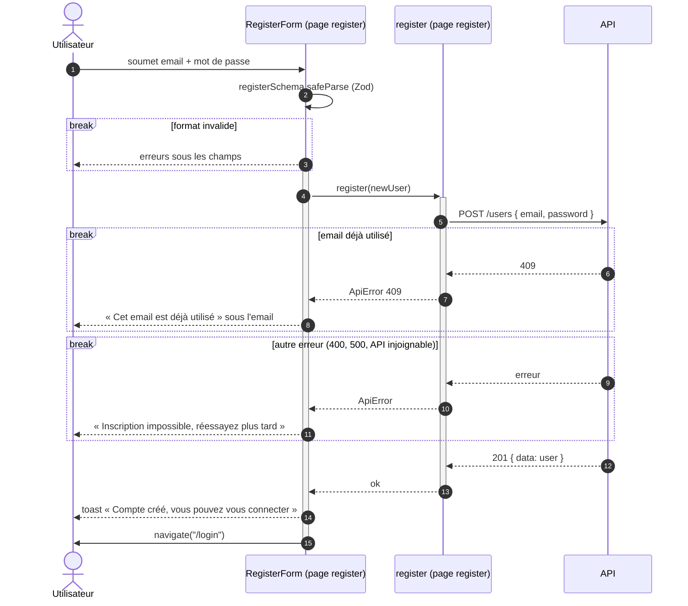

# Séquence — inscription côté client (livré)

Du formulaire d'inscription à la page de login :

- [`RegisterForm.tsx`](../../src/pages/register/ui/RegisterForm.tsx)
- [`register-schema.ts`](../../src/pages/register/model/register-schema.ts)
- [`register.ts`](../../src/pages/register/api/register.ts)

Le détail côté serveur est dans le
[diagramme de l'API](../../../api/docs/diagrams/create-user-sequence.md).

## Notes

- Chaque participant porte sa couche FSD. `registerSchema` reste dans la page
  `register` mais assemble `emailSchema` et `passwordSchema` de l'entité
  `user`, partagés avec le login. `apiFetch` (`shared/api`) n'est pas
  dessiné : `register` s'en sert et il lève une `ApiError` si la réponse
  n'est pas `ok`.
- La barre d'activation de `RegisterForm` correspond à `pending` : le bouton
  reste désactivé de l'appel jusqu'au `finally`.
- Pas de connexion automatique : `POST /users` ne pose pas de cookie.
  L'utilisateur se connecte ensuite, voir la
  [séquence de login](login-sequence.md).
- Ici `navigate()` est appelé explicitement : `isAuthenticated` ne change
  pas, aucune garde de route ne redirige à la place du formulaire.
